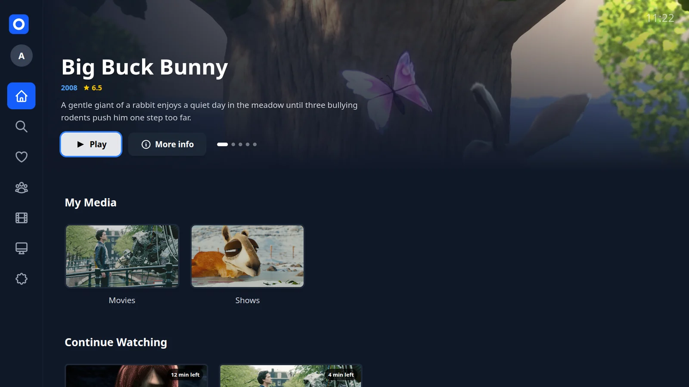
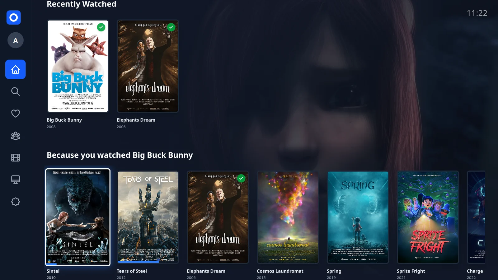
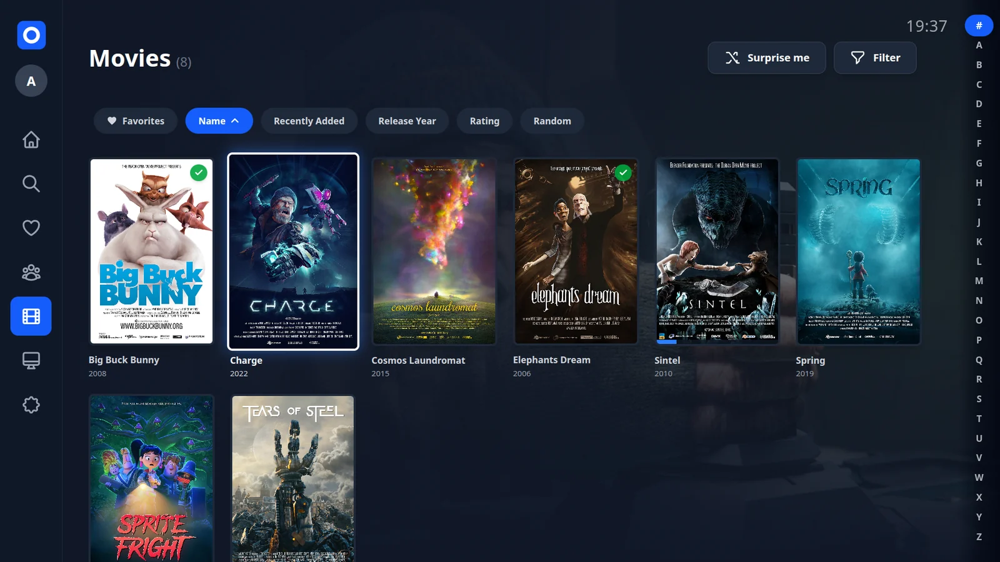
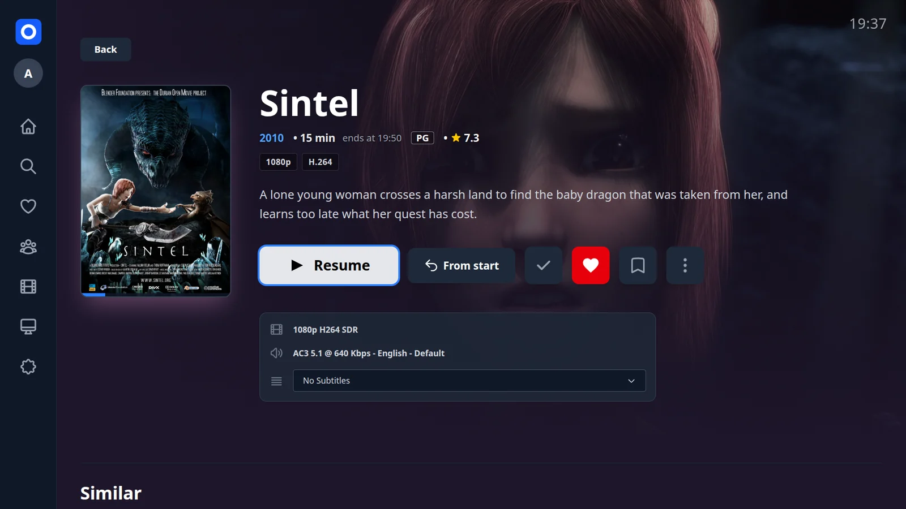
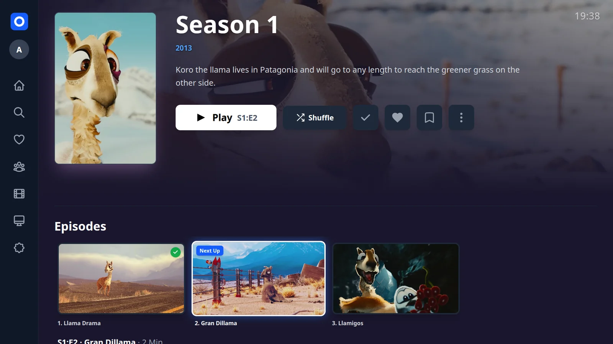
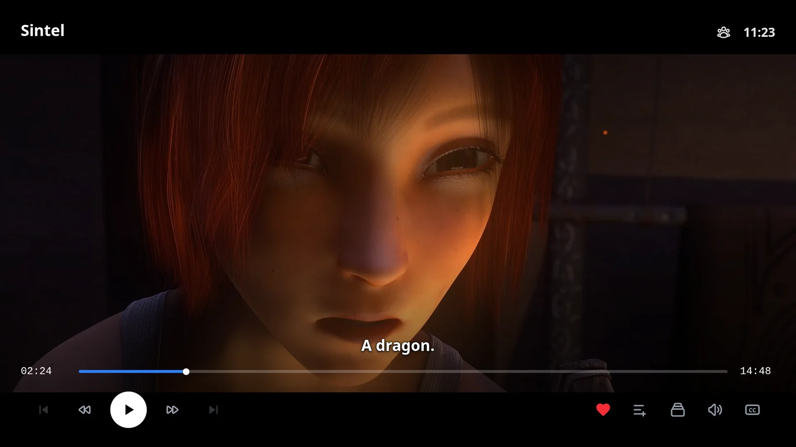
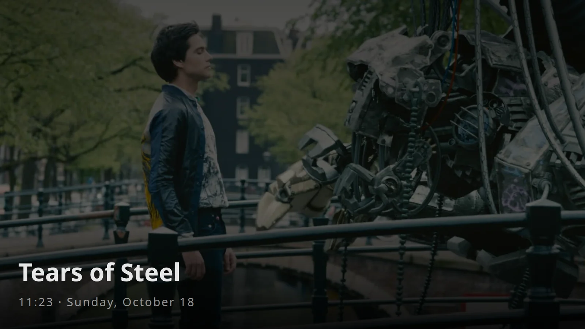
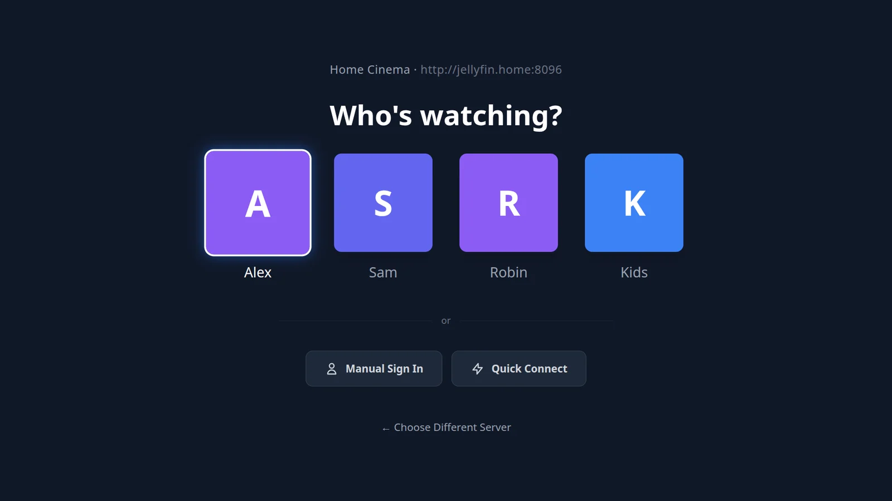
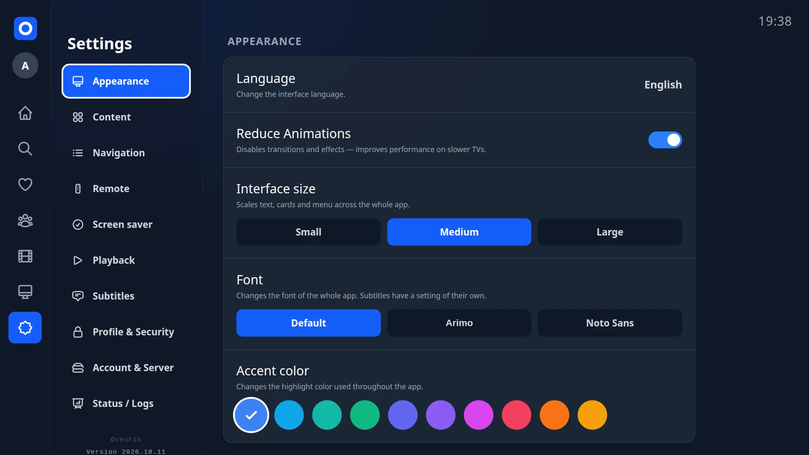

  

<h1 align="center">OcenFin</h1>

  A fast, lightweight Jellyfin client for LG webOS TVs — made for the remote, tested on an LG B4.

  
  
  
  

  

OcenFin plays your movies and shows as they are: Direct Play with Dolby Vision and Dolby Atmos, and subtitles drawn by the TV itself instead of burned in by the server. Everything is built for the D-pad, and the app, made with Svelte 5, takes up almost no space.

> **Movies and TV shows only.** OcenFin has no Live TV and no music, on purpose — the [FAQ](https://github.com/seluce/OcenFin/wiki) explains why. Libraries for music, Live TV, books, or home videos and photos do not appear in the app.

---

## Highlights

**Plays it as it is**

- Direct Play for 4K HEVC, AV1 and VP9 with Dolby Vision and HDR10, Dolby Atmos, TrueHD and DTS — the server only steps in when the TV really cannot play a file.
- Subtitles on the TV, not burned in: Blu-ray (PGS) and DVD (VobSub) pictures, ASS/SSA exactly as made thanks to libass, plain text in your own style.
- Skip intro, recap and credits (automatically if you like), a countdown to the next episode, “Are you still watching?” and preview pictures while seeking.

**Finding something to watch**

- A home screen with Continue Watching, Next Up, recent additions, “Because you watched …”, collections and your watchlist.
- Libraries with an A–Z jump, filters for genre and audio or subtitle language, sorting and “Surprise me”.
- Search across titles and people; title pages with cast, similar titles and the collections a title belongs to.
- Spoiler protection blurs the pictures of episodes you have not seen yet.

**Made for the TV**

- Everything works with the D-pad and the Magic Remote pointer, and Back always takes you to where you were.
- Remote shortcuts: colour buttons, channel keys to jump between episodes, number keys to jump in the timeline.
- Accent colours, interface size and font, an OLED-friendly screensaver and “Reduce animations” for a calmer screen.
- In English, German, Spanish, French, Italian, Dutch, Portuguese and Polish.

**Profiles and watching together**

- Fast profile switching with saved sign-in and Quick Connect; profile pictures made right on the TV.
- Shared profile: link two personal profiles and hide what one of you has already seen.
- SyncPlay, and remote control from Jellyfin on your phone or in the browser.

## Privacy

OcenFin talks to your Jellyfin server and nothing else: no tracking, no analytics, no extra account. Your settings stay on the TV. Trailers are the one exception, as they play from YouTube.

---

## Screenshots

<table>
  <tr>
    <td width="50%"> <b>Home</b> — what to watch next, and suggestions based on what you watched</td>
    <td width="50%"> <b>Library</b> — posters, A–Z jump, filters and sorting</td>
  </tr>
  <tr>
    <td> <b>Title page</b> — picture and sound at a glance, audio and subtitle choice</td>
    <td> <b>Seasons</b> — every episode, and the one that comes next</td>
  </tr>
  <tr>
    <td> <b>Player</b> — subtitles drawn on the TV, controls on demand</td>
    <td> <b>Screensaver</b> — artwork and clock, dimmed for OLED</td>
  </tr>
  <tr>
    <td> <b>Profiles</b> — pick who is watching, or sign in with Quick Connect</td>
    <td> <b>Settings</b> — accent colour, size and font</td>
  </tr>
</table>

The screenshots show the Blender Foundation's open movies with their real details and official subtitles, served by a demo server rather than a personal library.

---

## Requirements

- **TV:** an LG with **webOS 25 or newer** (2024 models onwards). Older webOS versions are not supported.
- **Server:** **Jellyfin Server 12.2 or newer.** On 12.0 or 12.1 OcenFin runs, but DVD subtitles stay empty. For servers older than 12.0, use **OcenFin 2026.09.22**, the last release for Jellyfin 10.10 and 10.11.

## Installation

OcenFin is installed as an `.ipk` file from the [Releases page](https://github.com/seluce/OcenFin/releases). **No root is required.**

1. **Prepare the TV:** Install the official "Developer Mode" app from the LG Content Store on your TV and enable it.
2. **Sideload from your PC:** I recommend **[dev-manager-desktop](https://github.com/webosbrew/dev-manager-desktop)**, an easy graphical tool to install apps on the TV.
3. **Keep it running:** LG limits developer apps to 50 hours. Install the **"Auto Dev Token Refresh"** app with `dev-manager-desktop` as well; it resets the timer in the background, so OcenFin never expires.

## Documentation & FAQ

Common questions — why there is no Live TV or music, how the watchlist and theme music work, why there is no build for older TVs — are answered in the [Wiki and FAQ](https://github.com/seluce/OcenFin/wiki).

---

## License

OcenFin is released under the [MIT License](LICENSE). Bundled components keep their own licenses: Svelte, Tailwind CSS, libbitsub, uqr, JASSUB, HarfBuzz and Brotli (MIT), hls.js (Apache-2.0), libass (ISC), FriBidi (LGPL-2.1+, source via [JASSUB](https://github.com/ThaUnknown/jassub)), FreeType (FTL), small Emscripten runtime parts (Zlib, BSL-1.0, NTP) and the fonts Arimo, Tinos, Noto Sans and Liberation Sans (SIL OFL 1.1). Portions of this software are copyright © The FreeType Project (freetype.org).

Screenshot artwork: *Sintel*, *Big Buck Bunny*, *Tears of Steel*, *Elephants Dream*, *Cosmos Laundromat*, *Spring*, *Sprite Fright*, *Charge* and *Caminandes* © Blender Foundation | [blender.org](https://www.blender.org), licensed under [CC BY](https://creativecommons.org/licenses/by/4.0/) 2.5, 3.0 or 4.0, via Wikimedia Commons; cropped and scaled for the screenshots. The episode still from *Caminandes: Gran Dillama* is licensed under [CC BY-SA 3.0](https://creativecommons.org/licenses/by-sa/3.0/), so the season screenshot (`docs/screenshots/series.webp`) is shared under CC BY-SA 3.0 as well.
